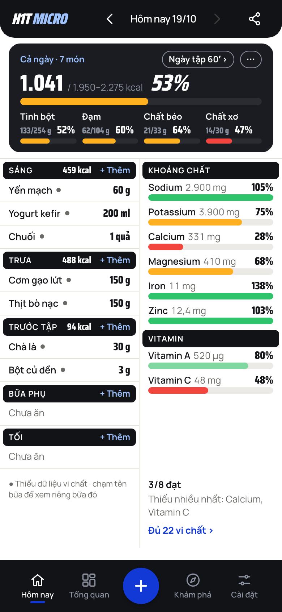
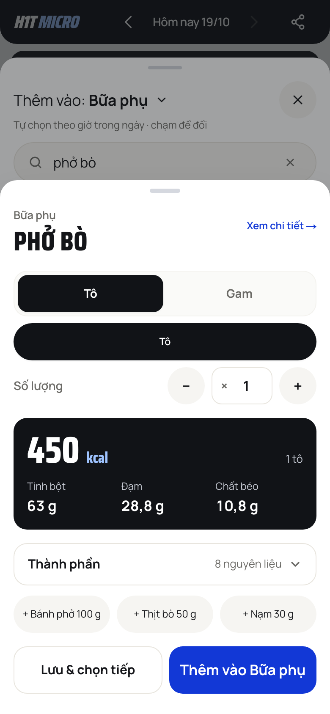
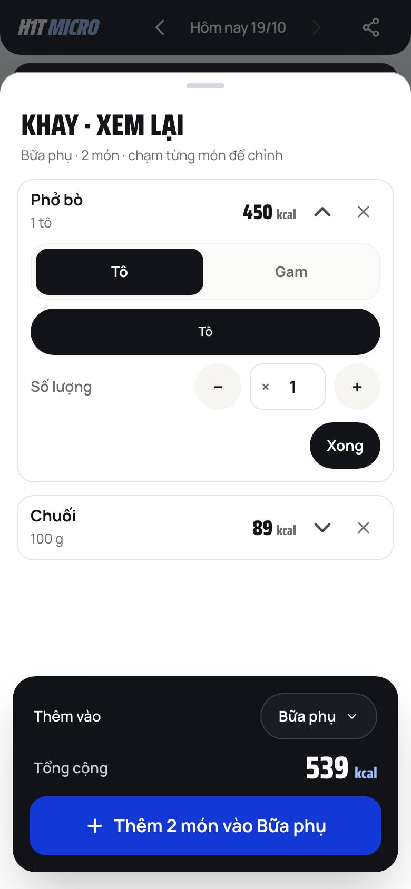
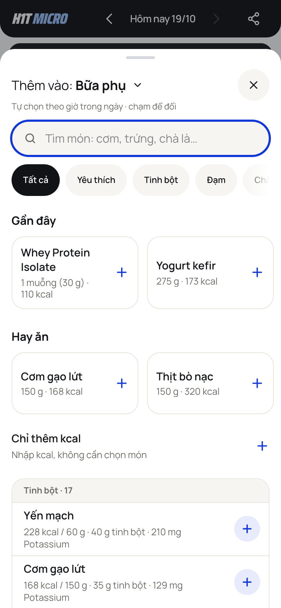
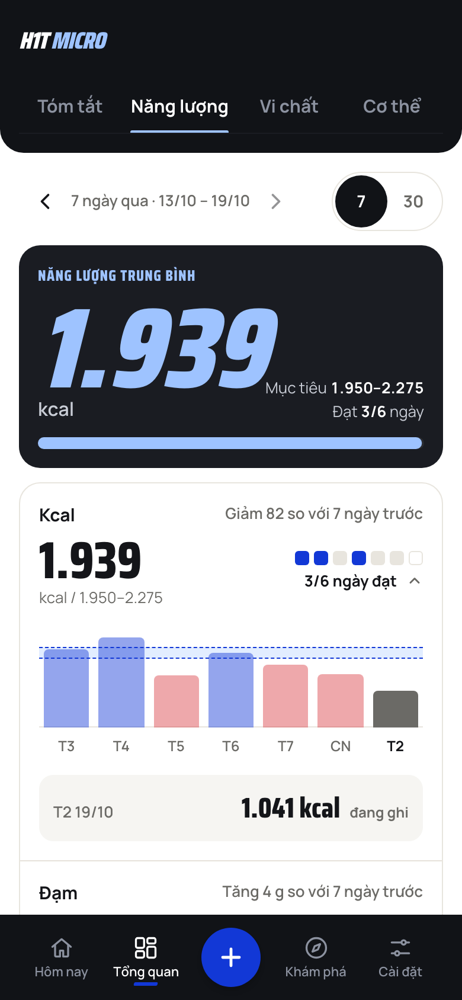
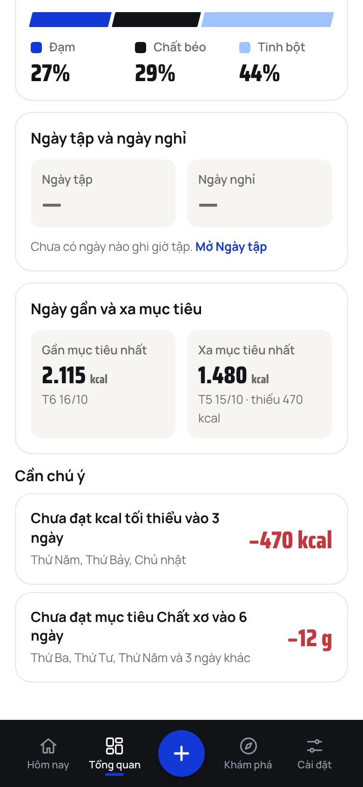
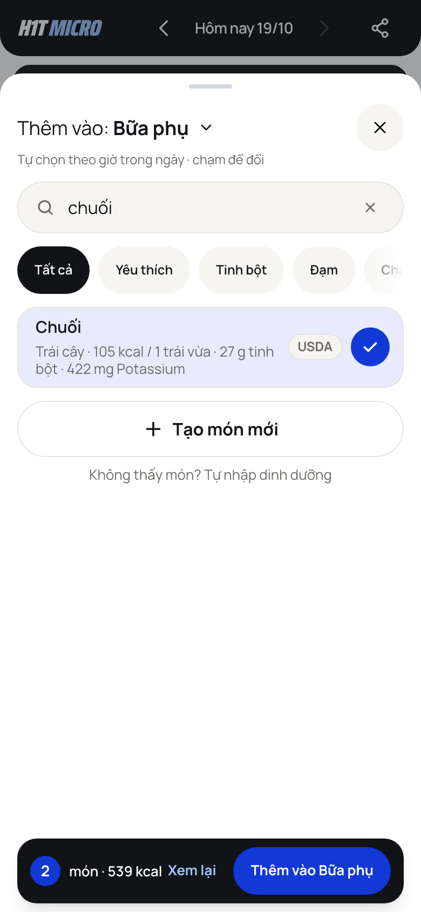

# Impeccable visual audit, 19/10/2026 (report only, no code changed)

**Method: source plus screenshot assessment. The detector did not run.** `scripts/impeccable` downloads an engine binary on first use, which the night rules forbid, so there is no `impeccable detect` output, no overlay and no deterministic scan: everything below is read from the source and from screenshots, and contrast ratios are computed from the token values. Nothing here is "verified by the detector".

- Branch assessed: the final branch of items 1 to 4 (`feat/ui-cc-54`, on cc-58, on cc-57), demo build, 390 × 844 at 2x, Chromium, one pass, no animation checks (the motion work is cc-57's).
- Screens (pictures in `impeccable-audit-2026-10-19/`, made by `apps/web/tests/probes/impeccable_shots.py`): Hôm nay, the /add sheet (list, portion panel, Khay bar, Khay review), Tổng quan › Năng lượng.
- Style is fixed: **Cobalt Sign**, paper `#F3F1EC`, card `#FFF`, ink `#111317`, cobalt `#1238D6`, sky `#9EC3FF`, Saira Condensed and Manrope. Nothing below proposes a new look; the items are hierarchy, spacing, density and polish inside it.
- Mode: Operate (app UI): scanability and consistency outrank expression.

## Implementation integrity verdict: pass

The screens read as one product-specific system, not a template. The ink band header with the italic wordmark, ink pills for meal and group names, the slanted active bar of the nav, Saira Condensed numerals on a fixed set of sizes, level bars in the four-level colours and the paper / white card pair are used the same way on every screen. Tokens come from `@theme` (no raw hex in the files read), the alignment check passes (`npm run test:align`), and the touch targets read as 44 px or more. The issues below are density and hierarchy slips inside a coherent system.

## Audit health score (estimated without the detector)

| # | Dimension | Score | Key finding |
|---|---|---|---|
| 1 | Accessibility | 3 | Contrast holds (table below); level words now reach screen readers (cc-58); the grey "●" marker is explained only in a footer sentence |
| 2 | Performance | 3 | Motion and bundle work done tonight; long lists are capped at 50 rows; nothing seen in the screenshots |
| 3 | Theming | 4 | Tokens used throughout; one theme by design (no dark mode in scope) |
| 4 | Responsive | 3 | Fits 390 without horizontal scroll; the portion panel and Khay stack many rows on a phone |
| 5 | Implementation integrity | 4 | Coherent, intentional, product-specific |
| | **Total** | **17 / 20** | Good: address the hierarchy items below |

Contrast, computed from the tokens: `muted-on-dark` on ink 5.96:1, `secondary` on paper 4.80:1, on card 5.41:1, sky on ink 10.36:1, cobalt on paper 7.26:1, `destructive-text` on card 5.30:1 (the plain `destructive` is 4.43:1, so it must stay off text; cc-58 moved the three form texts). No text pair fails AA.

## Must (fix before the next release; each costs a task or hides the main answer)

### M1. Hôm nay: the micro verdict sits at the foot of the column, under about 230 px of empty space

The right column lists 8 nutrients, then nothing, then "3/8 đạt · Thiếu nhiều nhất: Calcium, Vitamin C · Đủ 22 vi chất ›" at the very bottom. At 390 × 844 the gap between Vitamin C and the verdict is a third of the column; the sentence that answers "how am I doing on micros" is the least prominent text on the screen (13 px secondary, the count in bold). `components/home/nutrient-column.tsx:149` pins the block with `mt-auto` under the scroll area; the comment there says the space left by the whole-row cut sits above it.
Fix inside the style: put the verdict first in the column, under the group pill as a one-line "3/8 đạt" with the Saira numeral (the level bars already use it), and let the list start below it; or drop `mt-auto` so the space ends at the bottom of the column instead of splitting the content. `/impeccable layout`.

### M2. /add portion panel: a one-item chip row looks like a primary button and repeats the tab above it

For Phở bò the panel shows, top to bottom: a segmented "Tô | Gam" (Tô selected), then a full-width ink pill "Tô", then "Số lượng − × 1 +", then the kcal card. The ink pill is the size-chip row (`components/ui/portion-area.tsx:477-500`, a grid of one item): selected, 52 px, full width, ink, it is indistinguishable from a button and says the same word as the tab above. Three control rows (about 280 px) come before the 450 kcal result, and the cobalt "Thêm vào" is at the bottom. A one-person decision is told three times.
Fix: render the size chips only when there is more than one size (keep the grid for Bé / Vừa / Lớn), so a dish with one portion shows the toggle and the stepper only. `/impeccable distill`.

## Should (next pass)

### S1. Khay review: every opened line carries the whole portion editor

Opening Phở bò in "Khay · xem lại" shows the segmented toggle, the "Tô" pill, the stepper and "Xong": about 450 px for one line, so a tray of three needs scrolling to reach the total, while the card under it ("Thêm vào Bữa phụ ▾, Tổng cộng 539 kcal, Thêm 2 món vào Bữa phụ") is the decision point. `components/add/add-tray.tsx` (the Expand at about line 147 holds a `PortionArea`). Show the stepper and the unit only; the full editor is one tap away on the food's own sheet. Same fix as M2 helps. `/impeccable distill`.

### S2. /add list rows: the meta line runs to three lines

"228 kcal / 60 g · 40 g tinh bột · 210 mg Potassium" wraps to three lines at 13 px under each name (`components/foods/food-list.tsx:132`, `line-clamp-2` on the meta and the name). Each row is 74 px and a screen shows seven. Hôm nay's rows already put the amount on the right as a Saira numeral; do the same: name and one short line (kcal and portion) left, the add circle right, the micro detail on the food's page. `/impeccable layout`.

### S3. /add: two add affordances in one scroll

The shortcut cards (Gần đây, Hay ăn) end in a bare cobalt "+" (`components/add/add-shortcuts.tsx:79-90`), the list rows below end in a filled pale-blue circle with a "+" (the tray toggle in `components/foods/food-list.tsx`). They do different things (one tap logs; the circle puts a food in the tray) but look like the same control in two styles. The cards are also a fixed 11 rem wide, so their heights follow the name (the Whey card is three lines, Yogurt kefir one). Give one-tap logging the filled circle and the tray toggle the outlined one (or the reverse), and set the card meta to one line. `/impeccable polish`.

### S4. /add: the search field opens with a 2 px cobalt ring

Since cc-58 focus moves into the field on a phone (`app/(app)/add/page.tsx:125`), so the sheet opens with the full ring (`components/foods/food-search-field.tsx:18`, `focus-within:ring-2 focus-within:ring-blue`) before anyone has touched it. It competes with the selected "Tất cả" chip and the cobalt CTAs, and the first thing on the sheet is the loudest. Keep the ring for keyboard focus (`:focus-visible` on the input, through `has()`), and use the 1 px cobalt border for a touch focus. `/impeccable quieter`.

### S5. Tổng quan › Năng lượng: the hero and the first card say the same thing

The ink hero shows "1.939 kcal · Mục tiêu 1.950–2.275 · Đạt 3/6 ngày"; the card right under it repeats "Kcal 1.939 kcal / 1.950–2.275, 3/6 ngày đạt" with its own squares. The chart, the actual answer to "which days", starts below the middle of the screen, past the second 1.939. `components/overview/energy-tab.tsx:138-154` (the hero) and the first `macroScoreRow` (line 121); the hero's `HeroNumber` is 96 px (`components/overview/parts/hero-card.tsx`). Drop the Kcal row from the scoreboard (it is the hero) or fold the hero's two side lines into it. `/impeccable distill`.

### S6. Tổng quan: an empty block is drawn as two tiles of dashes

"Ngày tập và ngày nghỉ" with no training days shows two grey tiles holding "—" and the line "Chưa có ngày nào ghi giờ tập. Mở Ngày tập" (`components/overview/energy-tab.tsx:164`): a card inside a card for no data. When there is nothing to compare, one line and the link is enough; the tiles can come back with data. The same card-in-card shape sits under "Ngày gần và xa mục tiêu" (line 180), where it does carry data. `/impeccable distill`.

### S7. Tổng quan: the red deficit figures out-shout their own sentence
"−470 kcal" and "−12 g" are 26 px Saira Condensed bold in `destructive-text` (`components/overview/parts/attention-row.tsx:33`) beside a 15 px bold title and a 13 px line. The face is narrow and tall, so at 26 px the number is the first thing read and it is red; two rows in a row look like an alert state although the rows say "Chưa đạt" and are advice. Keep the figure but use `text-text` for the number and the red only for the minus sign and the unit, or bring it to 22 px. `/impeccable typeset`.

### S8. Hôm nay: the grey "●" is explained in a footer, away from where it appears
The grey dot after a food (no micro data for it) is explained by one sentence at the foot of the list, "● Thiếu dữ liệu vi chất · chạm tên bữa để xem riêng bữa đó" (`components/home/food-list.tsx:425`), a sentence that is also two instructions in one. With a longer day the explanation is below the fold from the dots. Put the explanation in the dot's accessible name and a one-time tip (the tips system exists), and shorten the footer to the first half. `/impeccable clarify`.

### S9. Hôm nay hero: the macro amounts are 12 px

In the four macro columns the amount ("133/254 g") is `text-xs` (12 px) muted on ink (`components/home/home-hero.tsx:117`), next to a 15 px percent. Contrast is fine (5.96:1), the size is the app's smallest body text and the only 12 px in the hero; every other secondary line in these screens is 13 px. Use 13 px if the 77 px column allows "118/104 g" (the comment in the file says the layout was tuned to 12), otherwise leave it and say so in the file. `/impeccable typeset`.

### S10. Khay bar and Thành phần chips: 12 px labels

The Khay bar is clear (count circle, "món · 539 kcal", "Xem lại", the cobalt action), but "Xem lại" is a 15 px text link beside the primary button with no 44 px chip of its own, and the new Thành phần chips (`components/ui/dish-parts.tsx`, `ChipGroup` `text-xs`) are 12 px with a two-line wrap in the narrowest column. Both pass the 44 px target; both could take 13 px. Minor.

## Patterns across the screens

1. **Repeated numbers.** The same value appears twice on one view in three places (the Tổng quan hero and card, the portion panel's "450 kcal" and the Khay row's "450 kcal" one tap later, Hôm nay's "3/8 đạt" and the bars it summarises). One owner per number is the cheapest hierarchy gain available.
2. **Control rows before the answer.** Both the portion panel and the Khay editor put 3 to 4 control rows above the result they change. The result should stay on screen while the controls are used.
3. **Small text is held at 12 to 13 px and the contrast is always sufficient**; the hierarchy comes from Saira numerals, and the places that lose are those where two Saira sizes meet (S7, S9).

## Positive findings (keep)

- Hôm nay's top half: the ink hero with the kcal numeral, the level bar and four macro columns is dense and readable; the meal pills with "+ Thêm" are a good, repeatable rhythm.
- The bottom nav's slanted active bar and the paper / ink split are distinctive and consistent across all tabs.
- The Khay footer card (meal selector, total, one action) is the right shape; Thành phần follows the same card language (border, 16 px radius, 48 px header).
- Level colours carry through bars, squares and chart without introducing a fifth hue; the red is reserved for deficits.

## Recommended order

1. **M2** `/impeccable distill` (portion panel: size chips only with a choice), then **S1** (Khay editor), the same idea.
2. **M1** `/impeccable layout` (Hôm nay's Vi chất verdict).
3. **S5, S6** `/impeccable distill` (Tổng quan Năng lượng).
4. **S2, S3, S4** `/impeccable polish` on /add (rows, one add affordance, a quieter field at rest).
5. **S7, S9, S10** `/impeccable typeset`, **S8** `/impeccable clarify`.
6. End with `/impeccable polish`.

Not covered: Hôm nay on a past day and in select mode, the other Tổng quan tabs, the 1024 px and wider layouts, dark surfaces other than ink cards, motion (cc-57), the live (non-demo) data. The detector would add a deterministic scan of the same files; run it when the binary may be downloaded.
