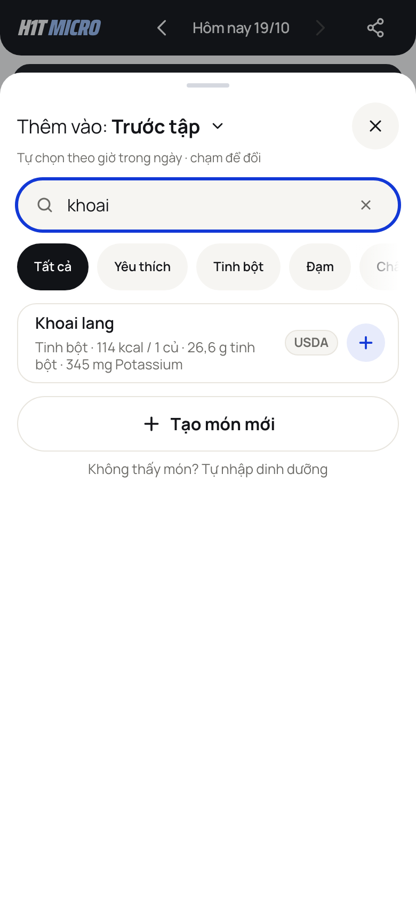
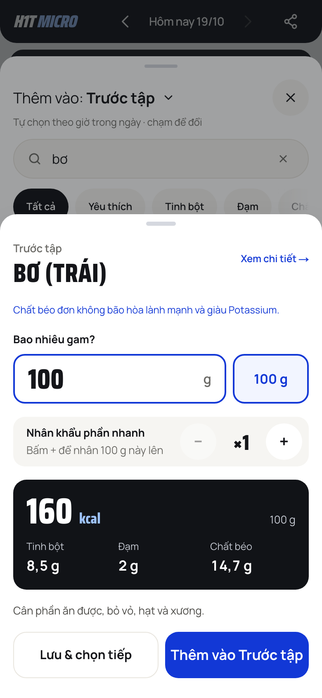
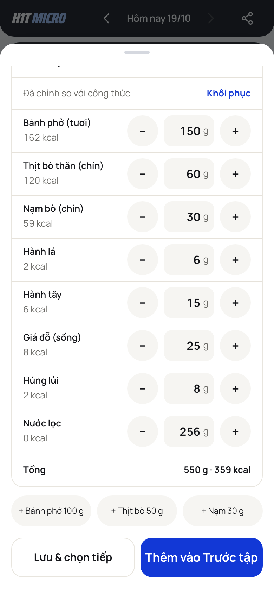
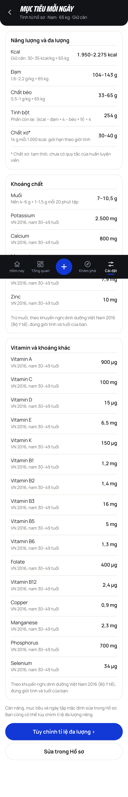
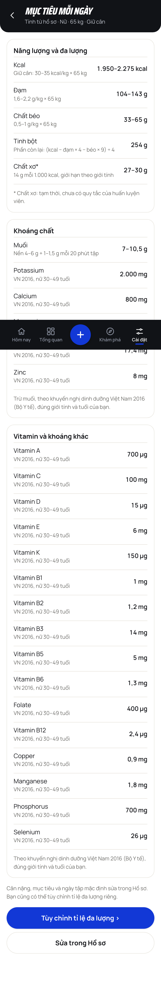

# cc-67: simple, fast food logging (feat/ui-cc-67)

> **BLOCKED: merge only together with Dong's Go port of `lib/rda.ts`. `TestSharedTargetVectors` and `trends_test` fail until then.**
> `packages/vectors/targets.json` has the new outputs (the 21 micro targets by sex and age, `age` in the input); the Go targets must read the same table.
> The edible-part portions JSON (`docs/data/edible-part-portions-2026-10-19.json`) needs Dong's importer.
> Not merged and no PR yet: cc-67 goes into `feat/ui-cc-68` through the cc-68 session; Dong opens the combined PR. This file is the PR body to reuse.

Branch `feat/ui-cc-67`, based on `origin/main` 390f7f4, `origin/main` 8656768 (cc-63) merged in. Web only: nothing under `apps/api`, the database, migrations or deploy. sw.js VERSION `2026-10-19.10`, release `2026-10-19a`.

## What changed, per part

1. **One row per food.** `lib/food-twins.ts` groups a raw row with its plain cooked row (the cc-53c pairs by source + source id, then names that differ only by sống / nấu chín / chín / luộc / hấp). Search, categories, Gần đây, Yêu thích, Hay ăn and Khám phá show one row; cơm, bún, phở, mì, miến, khoai, ngô and yến mạch open on Chín, meat, fish, vegetables and dry beans on Sống; Sống | Chín in the portion sheet reaches the other row. chiên, xào, nướng, kho rows stay separate, after the plain one. A food opens in the state it was last logged in. Diary rows and old entries are unchanged. The index loads after the first paint (`lib/food-rows.ts` facade) to hold the size budget.
2. **Edible part.** Fruit goes by grams of the edible part (100 g chip, typed grams, ×N), names stay plain (Bơ (trái) vs Bơ lạt); eggs keep their quả. Scan of the whole research catalogue: `docs/data/edible-part-scan-2026-10-19.md` (181 foods: 82 fruit, 43 fish, 56 with shell, peel or bone); importer file `docs/data/edible-part-portions-2026-10-19.json` for Dong.
3. **Editable dish parts.** In Thành phần each part has a gram field with − / + 10 g (0 = Không dùng), the add-on chips add a part, Khôi phục goes back. Saving logs ONE row ("Phở bò · đã chỉnh") whose numbers are the parts added up, through a one-off recipe (`Recipe.oneOff`, `POST /foods/custom`, offline-safe through the outbox). The one-off food is hidden by the recipe's local and server id; on a device with no recipe record a server food named "… · đã chỉnh" is hidden by name, unless this device made it through "Tạo món". An unchanged dish logs the normal dish.
4. **Micro targets = recommended amounts.** 21 of the 22 are the VN 2016 amounts (QĐ 2615/QĐ-BYT) by sex and age, one table in `lib/rda.ts` with the source table per row. **Sodium keeps the coach's training formula** (Hao's decision pending, `TODO` in `lib/targets.ts`, OPEN_QUESTIONS "cc-67 sodium"). Energy, macros, fiber, fast carbs and the Ngày tập checklist are unchanged. Gone: potassium per kg, calcium 1.200–1.500, magnesium = 50% calcium, iron by period. Age = this year less the year of birth (25 when unknown).
5. **Fewer taps.** From Hôm nay to a logged food (390 x 844, `tests/probes/cc_67_taps.py`), main → now: recent card 2 → 2, recent through the portion sheet 3 → 3, searched food 3 → 3, a dish with one part changed 5 (the + Thịt bò chip, nothing else changeable) → 5 (Thành phần, the gram field, Thêm), 4 the next time (Thành phần stays open on this device). /add opens on Gần đây and Yêu thích with the search field focused; closing the portion sheet puts the focus back in the search field. Also fixed: the second identical edited dish after a reload had no numbers.

Also: a logged entry's "Đã nấu chín" label survived being opened for edit only because the raw / cooked data now loads lazily, so the portion area waits for it before it starts (found by `cc_53_units.py`).

Release `2026-10-19a` (Có gì mới): Mỗi món một dòng, Ghi phần ăn được, Chỉnh thành phần món, Mục tiêu vi chất theo khuyến nghị; a 2-step tour (+ Thêm, the Thành phần of a dish, falling back to + Thêm on Hôm nay). The 18f tour step and tip copy about the dish parts is updated.

## For Dong

- Go port of `lib/rda.ts` (21 micro targets by sex and age; sodium stays the training formula) so `TestSharedTargetVectors` and `trends_test` pass; vectors are in `packages/vectors/targets.json` (input has `age`).
- Importer for `docs/data/edible-part-portions-2026-10-19.json` (portions to remove and renames of the foods with inedible parts).
- A flag on `POST /foods/custom` for a one-off edited dish would replace the name fallback that hides "… · đã chỉnh" on another device.

## Gates (final build, port 3101)

- `npm run typecheck`: clean.
- `npm test`: 133 files, 1701 passed, 2 skipped.
- `npm run build:demo`: ok.
- `npm run test:align`: all alignment checks passed (<= 1 px).
- `npm run test:hydration`: 0 hydration errors.
- Smoke (`tests/probes/smoke.py`): 144 PASS, 0 FAIL of 144.
- `npm run probe:all` (PROBE_WORKERS=3, at 2e05e8e): 101 PASS, 2 REPORT, 2 FAIL, 1 SKIP. The two FAIL, `cc_26.py` (share-card name line height, 1440 paper edge) and `cc_44.py` (share text overlap without fonts), fail the same way on a fresh build of `origin/main` 8656768 and are not from this branch. The REPORT ones are screenshot and audit reports; the SKIP is dev only.
- Probes updated with their change: `cc2_01`, `cc2_04`, `cc2_10`, `cc2_21`, `cc_16`, `cc_46`, `cc_53_units`, `cc_tutorials`, `cc08`, `cc2_12`, `cc_54_dish_parts`; new `cc_67_part1` to `part4`, `cc_67_taps`.

First-load JS, gzip kB, `npm run sizes` (branch / main 8656768 / delta; budget +2 kB):

| Route | Branch | Main | Delta |
|---|---|---|---|
| /signin | 210.1 | 211.0 (390f7f4) | −0.9 |
| /landing | 205.8 | 207.2 | −1.4 |
| /app | 297.5 | 297.6 | −0.1 |
| /add | 320.1 | 319.5 | +0.6 |
| /foods/food-cha-la | 287.8 | 287.8 | 0.0 |
| /entry/item-1 | 272.5 | 272.8 | −0.3 |
| /micros | 272.9 | 273.2 | −0.3 |
| /trends | 282.2 | 282.6 | −0.4 |
| /explore | 281.0 | 280.5 | +0.5 |
| /settings | 285.7 | 286.0 | −0.3 |
| /settings/profile | 281.9 | 282.3 | −0.4 |
| /training | 291.7 | 291.5 | +0.2 |

## Screenshots (390 x 844)

| Search "khoai" | Bơ (trái) portion panel | Phở bò with edited parts |
|---|---|---|
|  |  |  |

Targets screen, man of 30 and woman of 30 (band 30–49): `docs/screenshots/cc-67/targets-male-30.png`, `docs/screenshots/cc-67/targets-female-30.png`.

## The recommended amounts: nutrient, male / female value, unit, source, all 8 age bands

Source: Bộ Y tế, Viện Dinh dưỡng, *Nhu cầu dinh dưỡng khuyến nghị cho người Việt Nam*, QĐ 2615/QĐ-BYT (16/6/2016). Sodium is not in the table (it stays the coach's training formula). Generated by `npm run scan:rda` from `lib/rda.ts`; the first table is the 20–29 band, then one table per nutrient with every band.

Nguồn chính: Bộ Y tế, Viện Dinh dưỡng, *Nhu cầu dinh dưỡng khuyến nghị cho người Việt Nam*, ban hành kèm Quyết định 2615/QĐ-BYT ngày 16/6/2016 (VN 2016). Số liệu chép đúng như trong bảng: RDA, hoặc AI khi bảng không có RDA. VN 2016 có đủ cả 21 chất nên không cần lấy từ NIH ODS. Natri chưa theo bảng này: giữ công thức của huấn luyện viên (theo phút tập) cho đến khi Hao quyết định (VN 2016 ghi 2.000 mg là mục tiêu chế độ ăn). App chọn nhóm tuổi theo năm sinh (tuổi = năm nay − năm sinh).

## Nhóm 20–29 tuổi (nam, nữ)

| Chất | Đơn vị | Nam | Nữ | Nguồn |
|---|---|---|---|---|
| Calcium | mg | 800 | 800 | VN 2016 Bảng 16 |
| Phosphorus | mg | 700 | 700 | VN 2016 Bảng 17 |
| Magnesium | mg | 340 | 270 | VN 2016 Bảng 18 |
| Iron | mg | 7,9 | 17,4 | VN 2016 Bảng 19, khẩu phần hấp thu sắt 15%; nữ 20–49 tuổi là mức có kinh nguyệt, nữ từ 50 tuổi là mức đã mãn kinh |
| Zinc | mg | 10 | 8 | VN 2016 Bảng 20, mức hấp thu vừa |
| Selenium | µg | 34 | 26 | VN 2016 Bảng 22 |
| Copper | mg | 0,9 | 0,9 | VN 2016 Bảng 23, đổi từ µg |
| Manganese | mg | 2,3 | 1,8 | VN 2016 Bảng 25, AI |
| Potassium | mg | 2500 | 2000 | VN 2016 Bảng 47, mức tiêu thụ đủ (AI); mục tiêu chế độ ăn của WHO là trên 3.510 mg |
| Vitamin A | µg | 850 | 650 | VN 2016 Bảng 27, µg RAE |
| Vitamin D | µg | 15 | 15 | VN 2016 Bảng 28 |
| Vitamin E | mg | 6,5 | 6 | VN 2016 Bảng 29, AI, alpha-tocopherol |
| Vitamin K | µg | 150 | 150 | VN 2016 Bảng 30, AI |
| Vitamin B1 | mg | 1,3 | 1,1 | VN 2016 Bảng 31 |
| Vitamin B2 | mg | 1,5 | 1,2 | VN 2016 Bảng 33 |
| Vitamin B3 | mg | 16 | 14 | VN 2016 Bảng 35 |
| Vitamin B5 | mg | 5 | 5 | VN 2016 Bảng 36, AI |
| Vitamin B6 | mg | 1,3 | 1,3 | VN 2016 Bảng 37 |
| Folate | µg | 400 | 400 | VN 2016 Bảng 38, bảng in 300 cho nam 15–19 tuổi (IOM: 400) |
| Vitamin B12 | µg | 2,4 | 2,4 | VN 2016 Bảng 39 |
| Vitamin C | mg | 100 | 100 | VN 2016 Bảng 41 |

## Mọi nhóm tuổi

### Calcium (mg, VN 2016 Bảng 16)

| Nhóm tuổi | 10–11 | 12–14 | 15–17 | 18–19 | 20–29 | 30–49 | 50–69 | 70+ |
|---|---|---|---|---|---|---|---|---|
| Nam | 1000 | 1000 | 1000 | 1000 | 800 | 800 | 800 | 1000 |
| Nữ | 1000 | 1000 | 1000 | 1000 | 800 | 800 | 900 | 1000 |

### Phosphorus (mg, VN 2016 Bảng 17)

| Nhóm tuổi | 10–11 | 12–14 | 15–17 | 18–19 | 20–29 | 30–49 | 50–69 | 70+ |
|---|---|---|---|---|---|---|---|---|
| Nam | 1250 | 1250 | 1250 | 1250 | 700 | 700 | 700 | 700 |
| Nữ | 1250 | 1250 | 1250 | 1250 | 700 | 700 | 700 | 700 |

### Magnesium (mg, VN 2016 Bảng 18)

| Nhóm tuổi | 10–11 | 12–14 | 15–17 | 18–19 | 20–29 | 30–49 | 50–69 | 70+ |
|---|---|---|---|---|---|---|---|---|
| Nam | 210 | 290 | 350 | 350 | 340 | 370 | 350 | 320 |
| Nữ | 210 | 280 | 300 | 300 | 270 | 290 | 290 | 260 |

### Iron (mg, VN 2016 Bảng 19)

| Nhóm tuổi | 10–11 | 12–14 | 15–17 | 18–19 | 20–29 | 30–49 | 50–69 | 70+ |
|---|---|---|---|---|---|---|---|---|
| Nam | 7,5 | 10,2 | 11,6 | 11,6 | 7,9 | 7,9 | 7,9 | 7,3 |
| Nữ | 7 | 9,3 | 19,8 | 19,8 | 17,4 | 17,4 | 6,7 | 6,3 |

### Zinc (mg, VN 2016 Bảng 20)

| Nhóm tuổi | 10–11 | 12–14 | 15–17 | 18–19 | 20–29 | 30–49 | 50–69 | 70+ |
|---|---|---|---|---|---|---|---|---|
| Nam | 8,6 | 9 | 10 | 10 | 10 | 10 | 10 | 9 |
| Nữ | 7,2 | 8 | 8 | 8 | 8 | 8 | 8 | 7 |

### Selenium (µg, VN 2016 Bảng 22)

| Nhóm tuổi | 10–11 | 12–14 | 15–17 | 18–19 | 20–29 | 30–49 | 50–69 | 70+ |
|---|---|---|---|---|---|---|---|---|
| Nam | 32 | 32 | 32 | 32 | 34 | 34 | 34 | 33 |
| Nữ | 26 | 26 | 26 | 26 | 26 | 26 | 26 | 25 |

### Copper (mg, VN 2016 Bảng 23)

| Nhóm tuổi | 10–11 | 12–14 | 15–17 | 18–19 | 20–29 | 30–49 | 50–69 | 70+ |
|---|---|---|---|---|---|---|---|---|
| Nam | 0,7 | 0,7 | 0,89 | 0,89 | 0,9 | 0,9 | 0,9 | 0,9 |
| Nữ | 0,7 | 0,7 | 0,89 | 0,89 | 0,9 | 0,9 | 0,9 | 0,9 |

### Manganese (mg, VN 2016 Bảng 25)

| Nhóm tuổi | 10–11 | 12–14 | 15–17 | 18–19 | 20–29 | 30–49 | 50–69 | 70+ |
|---|---|---|---|---|---|---|---|---|
| Nam | 1,9 | 1,9 | 2,2 | 2,2 | 2,3 | 2,3 | 2,3 | 2,3 |
| Nữ | 1,6 | 1,6 | 1,6 | 1,6 | 1,8 | 1,8 | 1,8 | 1,8 |

### Potassium (mg, VN 2016 Bảng 47)

| Nhóm tuổi | 10–11 | 12–14 | 15–17 | 18–19 | 20–29 | 30–49 | 50–69 | 70+ |
|---|---|---|---|---|---|---|---|---|
| Nam | 1900 | 2400 | 2800 | 2800 | 2500 | 2500 | 2500 | 2500 |
| Nữ | 1800 | 2200 | 2100 | 2100 | 2000 | 2000 | 2000 | 2000 |

### Vitamin A (µg, VN 2016 Bảng 27)

| Nhóm tuổi | 10–11 | 12–14 | 15–17 | 18–19 | 20–29 | 30–49 | 50–69 | 70+ |
|---|---|---|---|---|---|---|---|---|
| Nam | 600 | 800 | 900 | 850 | 850 | 900 | 850 | 800 |
| Nữ | 600 | 700 | 650 | 650 | 650 | 700 | 700 | 650 |

### Vitamin D (µg, VN 2016 Bảng 28)

| Nhóm tuổi | 10–11 | 12–14 | 15–17 | 18–19 | 20–29 | 30–49 | 50–69 | 70+ |
|---|---|---|---|---|---|---|---|---|
| Nam | 15 | 15 | 15 | 15 | 15 | 15 | 20 | 20 |
| Nữ | 15 | 15 | 15 | 15 | 15 | 15 | 20 | 20 |

### Vitamin E (mg, VN 2016 Bảng 29)

| Nhóm tuổi | 10–11 | 12–14 | 15–17 | 18–19 | 20–29 | 30–49 | 50–69 | 70+ |
|---|---|---|---|---|---|---|---|---|
| Nam | 5,5 | 7,5 | 7,5 | 6,5 | 6,5 | 6,5 | 6,5 | 6,5 |
| Nữ | 5,5 | 6 | 6 | 6 | 6 | 6 | 6 | 6 |

### Vitamin K (µg, VN 2016 Bảng 30)

| Nhóm tuổi | 10–11 | 12–14 | 15–17 | 18–19 | 20–29 | 30–49 | 50–69 | 70+ |
|---|---|---|---|---|---|---|---|---|
| Nam | 120 | 150 | 160 | 150 | 150 | 150 | 150 | 150 |
| Nữ | 120 | 150 | 160 | 150 | 150 | 150 | 150 | 150 |

### Vitamin B1 (mg, VN 2016 Bảng 31)

| Nhóm tuổi | 10–11 | 12–14 | 15–17 | 18–19 | 20–29 | 30–49 | 50–69 | 70+ |
|---|---|---|---|---|---|---|---|---|
| Nam | 1,2 | 1,4 | 1,4 | 1,4 | 1,3 | 1,2 | 1,2 | 1,1 |
| Nữ | 1,1 | 1,3 | 1,2 | 1,2 | 1,1 | 1 | 1 | 1 |

### Vitamin B2 (mg, VN 2016 Bảng 33)

| Nhóm tuổi | 10–11 | 12–14 | 15–17 | 18–19 | 20–29 | 30–49 | 50–69 | 70+ |
|---|---|---|---|---|---|---|---|---|
| Nam | 1,4 | 1,6 | 1,7 | 1,7 | 1,5 | 1,4 | 1,4 | 1,3 |
| Nữ | 1,3 | 1,4 | 1,4 | 1,4 | 1,2 | 1,2 | 1,2 | 1,1 |

### Vitamin B3 (mg, VN 2016 Bảng 35)

| Nhóm tuổi | 10–11 | 12–14 | 15–17 | 18–19 | 20–29 | 30–49 | 50–69 | 70+ |
|---|---|---|---|---|---|---|---|---|
| Nam | 12 | 12 | 16 | 16 | 16 | 16 | 16 | 16 |
| Nữ | 12 | 12 | 14 | 14 | 14 | 14 | 14 | 14 |

### Vitamin B5 (mg, VN 2016 Bảng 36)

| Nhóm tuổi | 10–11 | 12–14 | 15–17 | 18–19 | 20–29 | 30–49 | 50–69 | 70+ |
|---|---|---|---|---|---|---|---|---|
| Nam | 4 | 4 | 5 | 5 | 5 | 5 | 5 | 5 |
| Nữ | 4 | 4 | 5 | 5 | 5 | 5 | 5 | 5 |

### Vitamin B6 (mg, VN 2016 Bảng 37)

| Nhóm tuổi | 10–11 | 12–14 | 15–17 | 18–19 | 20–29 | 30–49 | 50–69 | 70+ |
|---|---|---|---|---|---|---|---|---|
| Nam | 1 | 1,2 | 1,3 | 1,3 | 1,3 | 1,3 | 1,7 | 1,7 |
| Nữ | 1 | 1,1 | 1,2 | 1,2 | 1,3 | 1,3 | 1,5 | 1,5 |

### Folate (µg, VN 2016 Bảng 38)

| Nhóm tuổi | 10–11 | 12–14 | 15–17 | 18–19 | 20–29 | 30–49 | 50–69 | 70+ |
|---|---|---|---|---|---|---|---|---|
| Nam | 300 | 300 | 300 | 300 | 400 | 400 | 400 | 400 |
| Nữ | 300 | 400 | 400 | 400 | 400 | 400 | 400 | 400 |

### Vitamin B12 (µg, VN 2016 Bảng 39)

| Nhóm tuổi | 10–11 | 12–14 | 15–17 | 18–19 | 20–29 | 30–49 | 50–69 | 70+ |
|---|---|---|---|---|---|---|---|---|
| Nam | 1,8 | 2,4 | 2,4 | 2,4 | 2,4 | 2,4 | 2,4 | 2,4 |
| Nữ | 1,8 | 2,4 | 2,4 | 2,4 | 2,4 | 2,4 | 2,4 | 2,4 |

### Vitamin C (mg, VN 2016 Bảng 41)

| Nhóm tuổi | 10–11 | 12–14 | 15–17 | 18–19 | 20–29 | 30–49 | 50–69 | 70+ |
|---|---|---|---|---|---|---|---|---|
| Nam | 75 | 95 | 100 | 100 | 100 | 100 | 100 | 100 |
| Nữ | 75 | 95 | 100 | 100 | 100 | 100 | 100 | 100 |

Giữ nguyên: năng lượng, đạm, béo, tinh bột, chất xơ (công thức của huấn luyện viên). Natri giữ nguyên công thức theo phút tập. Bỏ: kali theo cân nặng, canxi 1.200–1.500, magie = 50% canxi, sắt theo kỳ kinh.
