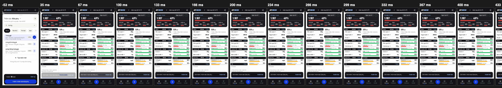
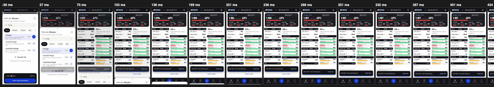

# feat/fluid-add: one motion for adding food

The problem was not dropped frames (Hao's Samsung recording at 120 fps shows almost none) but the choreography: the add sheet drew a
copy of Hôm nay under itself and hard-cut away when a food was added, Hôm nay drew an empty first frame, the first open of the
calendar or ⋯ was 300 ms late, the press showed late, and the toast was a different element from one add to the next. This PR
changes the structure underneath rather than tuning durations. **Open for Hao's review, not merged** (it is a routing change).

Base: origin/main 619a59b (PR #31 merged in). PR #29 (feat/ui-ag-18) is not on main yet, so its iOS keyboard change is not here:
the search field takes focus when the slide has settled (item 5) and #29 is the part that makes the iOS keyboard behave; merge
order does not matter for the code (no shared file), but check the field on an iPhone after both are in.

## What changed (the brief's items)

| # | What | Where |
|---|---|---|
| 1 | `/add` is an intercepting route in the tabs layout (`@sheet/(.)add`): the real screen under the sheet stays mounted and is never redrawn; a link or a reload gets `app/(app)/add/page.tsx` (the same `AddScreen`, on plain paper). The backdrop copy of Hôm nay is gone. The sheet's first frame is the sheet (the list, carousels and chips are a second, low-priority render), one layout is drawn instead of both, and the slide counts from the tap (one frame caught up, so it is on screen in the first frame it exists and still starts at the bottom edge). | `app/(app)/(tabs)/@sheet/**`, `components/add/add-screen.tsx`, `hooks/use-food-browse.ts` |
| 2 | Hôm nay: a visit after the first draws everything at once; `m-content-in` only after a real skeleton; the first app load keeps the two-step draw with a skeleton shaped like the list and the nutrient column. | `components/home/home-screen.tsx` |
| 3 | Every add (tray, portion sheet, one tap, Chỉ ghi kcal) slides the sheet away exactly like the ✕, then goes back past the sheet entries. The tray is left alone while it goes: the button never says "Thêm 0 món". | `leave()` in `add-screen.tsx`, `lib/sheet-history.ts` |
| 4 | With Hôm nay mounted, the kcal count-up, the bar growth and the new row's rise play after every add (checked frame by frame in `fluid_add.py`). | (follows from 1) |
| 5 | The meal name is known before the first frame (`useSyncExternalStore`, not an effect). Phone search focus waits for the slide's `transitionend` (never a third motion under the sheet). | `lib/use-meal-slot.ts`, `add-screen.tsx` |
| 6 | ✕ (and the scrim, a drag, an add): `data-state="closed"` and `pointer-events: none` by CSS at the tap; nothing is made inert until the slide is over. | `globals.css`, `leave()` |
| 7 | Release physics: one WAAPI animation with a `linear()` easing sampled from a damped spring, started in the same pointerup, from the live position with the finger's own speed (the old spring was given px/s where it needed progress per second). The `motion` chunk (18.5 kB gzip) is no longer loaded. | `lib/sheet-physics.ts`, `components/ui/sheet-drag-controller.ts`, `use-sheet-drag.ts` |
| 8 | The lazy sheets on Hôm nay (calendar, ⋯, copy, meal menu, sources, explainer, share, select mode) were `next/dynamic`: a dynamic component that suspends the first time it renders is shown 300 ms after its fallback, which was the whole first-open delay. Their modules are resolved on the first touch or when idle and each sheet is mounted closed once they are in. | `home-screen.tsx` |
| 9 | One toast element for the app: a new or updated toast changes its text and action in place; its host rides up over the Khay bar with a transition instead of swapping classes. Swipe: its own flick speed (0.11 px/ms), a second pointerdown ignored, the inline transition cleared when it ends. | `components/diary-toast.tsx`, `use-toast-swipe.ts`, `toast.tsx` |
| 10 | Touch drag: a dropped row is drawn in from where the copy under the finger was (translate and scale); the hold shows a tint that deepens over 500 ms, then the 160 ms lift. | `lib/use-touch-drag.ts`, `lib/touch-drag-landing.ts`, `row-motion.ts`, `globals.css` |
| 11 | Press feedback on touch-down: `lib/press-feedback.ts` marks the pressed control `data-pressed` at the pointerdown (touch and pen); the `active:` variant and the press rules match it like `:active`. On ink: a light wash (bottom nav, Hôm nay pills). | `lib/press-feedback.ts`, `touch-active.tsx`, `globals.css` |
| 12 | Explore → "Giàu …": the header and chips answer first, the ranked list is a second render. | `app/(app)/explore/rich/[nutrient]/page.tsx` |
| 13 | Tabs: still no animation; nav highlight and screen within 100 ms at 4x (measured below). | (home-screen, see 2) |
| 14 | Reduced motion: an unlayered `:is(:active, [data-pressed]) { scale: none }`, PillButton `motion-reduce:active:scale-100`, the TrayCard `m-pop` removed, `/add` and the portion sheet 300 ms (the others stay 350), the day-key comments fixed, the stacking cards gated, the dead hover on the landing phone deleted. | `globals.css` and the files named in the commit |

Not touched, as asked: the 1:1 sheet drag and grab-back, the sheet curve, the toast swipe's behaviour, the day slide, scrolling, tabs without animation.

## Measured: before and after

Phone 390 × 844 (devicePixelRatio 2), demo build, headless Chromium; **1x** is the machine as it is, **4x** is CDP `Emulation.setCPUThrottlingRate` 4.
Median of 5 runs. "Before" is origin/main 16d276c built and served as it was, "after" is this branch with main merged in. Frame times come
from `requestAnimationFrame` samples in the page (so they are frame start times: an absolute number is a few ms optimistic, before and
after use the same method); blank frames come from the CDP screencast (a frame whose lower page is one flat colour). The probe is
`apps/web/tests/probes/_fluid_add_measure.py` (a helper: `probe:all` skips names that start with `_`; it takes minutes and asserts
nothing); the assertions are in `fluid_add.py`. Raw numbers: `docs/pr/fluid-add-probe-before.json` and `…-after.json`.

**The targets of the brief:** + → first sheet frame ≤ 2 frames at 1x and ≤ 100 ms at 4x (**4 frames, 64 ms → 2 frames, 30 ms at 1x; 6 frames,
128 ms → 2 frames, 29 ms at 4x**), the sheet always starts from the bottom (its first visible frame is at 742–754 px of 844, at both rates), no blank frame on the way in (1 → 0), the add slides
the sheet away (0 → 12 frames of movement, 5 of 5 hard cuts → 0), the kcal count-up and the bar play after an add (1 → 16 and 1 → 18
distinct values), the first open of the calendar and ⋯ is as fast as the second (335 ms → 35 ms), the "Giàu" tile answers in 16 ms
(37), nav highlight and screen in ≤ 100 ms at 4x on a tab change (30–47 ms before and after; Hôm nay's list no longer one frame
behind its frame: 47 → 31 ms, the empty-list frame and the blank frame at 4x are gone).
`release`: the release is now one WAAPI animation started in the same pointerup (the first frame after release moves the sheet as far
as the finger did: 33 px against 39 per frame, no frame without movement); the slide ends in 330 ms against 596.

Filmstrips (frames from just before the tap, each labelled with ms since it; a frame with a red outline is blank):
- Open (tap on +): [before 1x](../screenshots/fluid-add/before/open-1x.png), [after 1x](../screenshots/fluid-add/after/open-1x.png), [before 4x](../screenshots/fluid-add/before/open-4x.png), [after 4x](../screenshots/fluid-add/after/open-4x.png)
- Close with the ✕: [before 1x](../screenshots/fluid-add/before/close-1x.png), [after 1x](../screenshots/fluid-add/after/close-1x.png), [before 4x](../screenshots/fluid-add/before/close-4x.png), [after 4x](../screenshots/fluid-add/after/close-4x.png)
- Add from the tray (the hard cut becomes the slide, with the count-up behind it): [before 1x](../screenshots/fluid-add/before/addtray-1x.png), [after 1x](../screenshots/fluid-add/after/addtray-1x.png), [before 4x](../screenshots/fluid-add/before/addtray-4x.png), [after 4x](../screenshots/fluid-add/after/addtray-4x.png)
- Tab to Hôm nay: [before 1x](../screenshots/fluid-add/before/tab-today-1x.png), [after 1x](../screenshots/fluid-add/after/tab-today-1x.png), [before 4x](../screenshots/fluid-add/before/tab-today-4x.png), [after 4x](../screenshots/fluid-add/after/tab-today-4x.png)





#### openclose

| | before 1x | after 1x | before 4x | after 4x |
|---|---:|---:|---:|---:|
| open first sheet frame (ms) | 64.3 | 29.8 | 128.2 | 28.9 |
| open first sheet frame (frames) | 4 | 2 | 6 | 2 |
| open first frame top (px, 844 = bottom) | 754.2 | 742.4 | 753.9 | 742.4 |
| open blank frames | 1 | 0 | 1 | 0 |
| open janky >16.7 / >33 ms | 0 / 0 | 0 / 0 | 1 / 0 | 1 / 0 |
| close slide frames | 12 | 12 | 12 | 12 |
| close hard cuts (runs) | 0 | 0 | 0 | 0 |
| close blank frames | 0 | 0 | 0 | 0 |
| close janky >16.7 / >33 ms | 0 / 0 | 0 / 0 | 0 / 0 | 0 / 0 |

#### addtray

| | before 1x | after 1x | before 4x | after 4x |
|---|---:|---:|---:|---:|
| tray add slide frames | 0 | 12 | 0 | 11 |
| tray add hard cuts (runs) | 5 | 0 | 5 | 0 |
| tray button said Thêm 0 (runs) | 0 | 0 | 0 | 0 |
| kcal count-up steps | 1 | 16 | 1 | 16 |
| kcal bar steps | 1 | 18 | 1 | 18 |
| tray add blank frames | 0 | 0 | 0 | 0 |
| tray add janky >16.7 / >33 ms | 0 / 0 | 0 / 0 | 0 / 0 | 0 / 0 |

#### tabs

| | before 1x | after 1x | before 4x | after 4x |
|---|---:|---:|---:|---:|
| tab -> Khám phá nav highlight (ms) | 30.6 | 30.7 | 45.3 | 44.9 |
| tab -> Khám phá screen (ms) | 30.6 | 30.7 | 45.3 | 44.9 |
| tab -> Hôm nay nav highlight (ms) | 31.5 | 30.5 | 30.4 | 31.1 |
| tab -> Hôm nay screen (ms) | 31.5 | 30.5 | 30.4 | 31.1 |
| tab -> Hôm nay food list drawn (ms) | 31.5 | 30.5 | 47.1 | 31.1 |
| tab -> Hôm nay empty-list DOM frames | 0 | 0 | 1 | 0 |
| tab -> Hôm nay blank frames | 0 | 0 | 1 | 0 |

#### rich

| | before 1x | after 1x | before 4x | after 4x |
|---|---:|---:|---:|---:|
| Giàu tile pressed (ms) | 34.3 | 16.2 | 37.4 | 15.7 |
| Giàu screen (ms) | 38.9 | 37.9 | 69.3 | 53.9 |

#### sheets

| | before 1x | after 1x | before 4x | after 4x |
|---|---:|---:|---:|---:|
| calendar first open (ms) | 334.6 | 34.5 | 346.7 | 49.1 |
| calendar second open (ms) | 33.9 | 33.3 | 33.5 | 33.8 |
| ⋯ menu first open (ms) | 333.9 | 34.8 | 347.4 | 31.2 |
| ⋯ menu second open (ms) | 34.5 | 32.8 | 33.6 | 34.9 |

#### release

| | before 1x | after 1x | before 4x | after 4x |
|---|---:|---:|---:|---:|
| close: finger px/frame | 39.4 | 39.4 | 39.4 | 39.4 |
| close: first frame after release (px moved) | 33 | 33 | 33 | 33 |
| close: frames with no movement after the release | 0 | 0 | 0 | 0 |
| close: slide ends (ms) | 596.6 | 329.8 | 596.1 | 330.2 |
| snap: finger px/frame | 1.7 | 1.7 | 1.7 | 1.7 |
| snap: first frame after release (px moved) | 9 | 9 | 9 | 9 |
| snap: frames with no movement after the release | 0 | 0 | 0 | 0 |


## Review fixes (21/10, after Hao's review)

| # | What | Where |
|---|---|---|
| 1 | **Stuck sheet after an add from another tab.** `router.replace("/app")` from Khám phá, Tổng quan or Cài đặt left the sheet's slot as it was (Next keeps a parallel slot's state on a soft navigation when the new URL matches none of its pages): the panel stayed mounted, closed, with `[data-app-frame]` inert, so the app took no taps. The slot now has a page that draws nothing for each tab (`@sheet/app`, `explore`, `trends`, `settings`). A `[...catchAll]` would do it in one file, but the build refuses it ("Every page must be part of at least one complete route": strict route matching leaves `/add` without a canonical route). Probe `add_from_tabs.py`: from the three tabs, tray add, one-tap add and ✕, then a reload on /add and an add; it failed before the fix (a nav tap was intercepted by the body) and passes after. | `app/(app)/(tabs)/@sheet/{app,explore,trends,settings}/page.tsx`, `default.tsx` |
| 2 | **PR #29's /add behaviours, ported into `add-screen.tsx`** (see the note for Dong below): the page behind the phone sheet is locked, counted (`lib/body-scroll-lock.ts`, the Sheet uses it too, so the portion sheet closing first no longer gives the page its scroll back under the add sheet); the panel lifts above the keyboard from `visualViewport` (resize and scroll) with the `translate` property, never `transform` (the drag and the release own it); the search field is focused once after the slide (a done flag, nothing if the panel was touched during the slide, at once under reduced motion, listeners and timer cleared); a first letter waits 120 ms before the list follows it, two letters or more do not (`hooks/use-food-browse.ts`). | `components/add/add-screen.tsx`, `components/ui/sheet.tsx`, `lib/body-scroll-lock.ts`, `hooks/use-food-browse.ts` |
| 3 | **The day under the sheet no longer flips.** Hôm nay read `date` from the live address, so an opener that carries none (older days: the meal's + Thêm, the first-run, the desktop intro, a read-only day) flipped the day to today under the sheet and back. The day is read only while the pathname is /app. The probe fails without the fix (the header went "Chủ nhật 18/10" → "Hôm nay 21/10"). | `components/home/home-screen.tsx` |
| 4 | **Double add.** Every add function returns at once when the sheet is already closing; the portion sheet's Thêm also takes the add lock before its first await (two clicks in one frame added two entries: 7 → 9 before the fix, 7 → 8 after). | `components/add/add-screen.tsx` |
| 5 | **Probes at full strength again.** `fluid_add.py` samples the hold tint every frame (rising, at least four values, from under 0.5 by at least 0.3) instead of accepting a tint stuck at 1; `cc_62_sheet.py` checks the WAAPI release for real (one animation on the panel, `linear()` easing, 100–400 ms, back to `translateY(0px)`, cancelled once settled) instead of "no chunk was fetched"; `cc_49.py` part 4 (live build, by hand) accepts the report's `/add` only when the sheet was closing then, and the sheet is gone after. New: `add_from_tabs.py` (item 1, `?meal=` from the link and from the sheet over Hôm nay, Android back during the slide, the rapid double add, the day under the sheet, and item 2's scroll lock, keyboard lift, focus and debounce). | `tests/probes/` |
| 6 | **Lazy sheets.** The nine closed sheets are mounted in `startTransition`, and the chunks are no longer fetched from the touch on the + (the next touch or the idle moment loads them, and only while Hôm nay is the page). Not done: Calendar, CopyYesterday and Sources still read the diary context while closed: a closed Sheet returns null, so each re-render costs nothing, and avoiding it means splitting their title and description out of the Sheet props. | `components/home/home-screen.tsx` |
| 7 | `.m-sheet[data-state="closed"] *` is gone: pointer-events inherits from the sheet; the drag-handle exception stays (`[data-sheet-drag]`). `motion.test.ts` checks there is no universal selector. | `app/globals.css` |
| 8 | **Render cost.** `listPick` is memoised (the callbacks read the latest handlers through a ref), the empty state and the create-food link too, and `FoodList` is `React.memo`: a keystroke in the grams field does not redraw the rows; the query stays urgent and the list deferred. | `components/add/add-screen.tsx`, `components/foods/food-list.tsx` |
| 9 | The unused `motion` dependency is gone (`package.json` and the lockfile: `motion`, `framer-motion`, `motion-dom`, `motion-utils`; nothing imports it). | `package.json`, `package-lock.json` |

**Route table.** Next 16's webpack build prints no First Load JS column, so `tests/probes/_route_js.py` loads each route cold (390 px phone, demo build) and adds up the gzip size of every script until the network is idle:

| Route | origin/main | feat/fluid-add |
|---|---|---|
| /app | 55 scripts, 400.4 kB | 55 scripts, 401.4 kB |
| /add (opened straight) | 46 scripts, 376.5 kB | 28 scripts, 267.6 kB |
| /explore | 45 scripts, 366.5 kB | 45 scripts, 368.6 kB |

/app and /explore carry about 1–2 kB more (the slot and the sheet's code in the tab frame); /add opened straight loads about 109 kB less (no `motion` chunk, and the sheet code no longer sits in the page twice).

**For Dong (PR #29, `feat/ui-ag-18`).** The edits #29 makes to `app/(app)/add/page.tsx` (scroll lock, keyboard lift, focus after the slide, the 1-letter debounce) are in `components/add/add-screen.tsx` and `hooks/use-food-browse.ts` here, where the page's code moved. When you merge main into #29, take main's version of those add files (the page is now a two-line wrapper); the rest of #29 (search.ts, api-client, scripts) does not touch them.

## Routing and back-button behaviour (changed)

- **`/add` from a tab** (the + of the nav, a meal's + Thêm, the sidebar button): the URL is still `/add` (or `/add?meal=…&date=…`), but
  the tab under the sheet is not replaced: it stays mounted (same elements, same scroll) and is inert while the sheet is up. Hôm nay on
  yesterday keeps its day under the sheet (the nav's + opens `/add?date=…`, which the screen under it reads).
- **Back** closes the sheet and shows the tab as it was; **Forward** reopens the sheet. The browser's Back gesture still plays the
  sheet-down view transition (`lib/nav-direction`); ✕, the scrim, a drag and Esc slide the sheet themselves and then go back.
- **A reload on `/add`, a shared link, or `/add` opened from a page outside the tabs** (a food, a setting): `app/(app)/add/page.tsx`,
  the sheet over plain paper (the copy of Hôm nay is gone), no tab frame. ✕ goes back, or home when there is nothing to go back to.
- **After an add** the sheet slides away, then the history goes back past the sheet's entries (`history.go(-(1 + sheet entries))`) when
  the sheet came from Hôm nay: one entry fewer than before, and Back from Hôm nay never reopens the sheet. (Before: a `push` to
  Hôm nay left `/add` behind it.) From another tab the entry is replaced by Hôm nay after the slide.
- The nav highlight stays on the tab the sheet was opened from (it used to jump to Hôm nay).
- Known edge, same as before: opened from a page outside Hôm nay with a portion sheet still open, an add replaces the portion sheet's
  entry by Hôm nay and leaves the `/add` entry behind it.

## Gates

```
gate:full: 642 s wall clock   (feat/fluid-add head, port 3126)
  typecheck       ok      0 s
  vitest          ok      6 s   (163 files, 2073 tests, 1 skipped)
  build:demo      ok      7 s
  test:align      ok     73 s
  test:hydration  ok    109 s
  probe:all       ok    629 s   probe:all: 112 PASS, 4 REPORT, 0 QUAR, 0 FAIL, 1 SKIP (cc02-final, dev only)
gate:full: all green
```
- `apps/api` is untouched (no `go vet` / `go test` needed). No migration, no deploy.
- The first gate:full run failed two probes, both timing assumptions the change broke, not behaviour: `cc12.py` waited 300 ms for the calendar to land (it used to open 300 ms late, now at once) and `cc_57_strips.py` aimed a touch at a 24 px grabber that, one frame into the slide, moves 8 px per ms of animation time (slowed to 0.2 % instead of 2 %). Both fixed in the probe; the second run is the green one above.
- By hand, on a live-mode build (`LIVE_BUILD=1`, not part of probe:all): `cc_68.py` (A, B, C, D, E: offline add, yesterday add through `/add?date=…`, sync status, sign-out) passes, `hotfix_late_writes.py` and `hotfix_recipes.py` pass, `cc_49.py` passes except its part 7, which fails the same way on origin/main.
- New: `tests/probes/fluid_add.py` (what the flow promises; in the gate, tagged smoke), `tests/probes/_fluid_add_measure.py` (the numbers above), unit tests for the sheet physics, the controller, the sheet entries, press feedback, the touch-drag landing, the toast swipe, the nav's +, the lazy sheets and the new CSS rules (`motion.test.ts`).


## For Hao

Decisions and checks that are yours; the same lines are in `OPEN_QUESTIONS.md` (feat/fluid-add):
- **No release note and no sw.js bump.** 2026-10-21b is pinned to its items and sw.js is unchanged. What people see: the sheet at once, the press at the touch, the first open of the calendar as fast as the second. Add a "Có gì mới" line at the merge if you want one, with the next sw.js VERSION.
- **iOS keyboard.** The phone search field takes focus when the slide has settled. On iOS a `focus()` outside the tap's call stack does not raise the keyboard (it did not after the route change either); PR #29 is the iOS keyboard work and was not on main, so it is not built on. Please check the field on an iPhone once both are in.
- **A reload on `/add`** draws the sheet over plain paper (the copy of Hôm nay is gone, as asked). Hôm nay under a reloaded `/add` too would mean Hôm nay as the slot's `default` page for `/add`: bigger, not done.
- **The `motion` package** is no longer imported anywhere (the sheet spring was its only use). Removing it needs an `npm install`, which this run does not do.
- **Press on touch-down** marks the control at the pointerdown (touch and pen); a touch that turns into a scroll cancels the pointer and clears the mark. Please check on the Samsung that a swipe over the food list never leaves a pressed row.
- **Read as asked** from short names in the brief: "fix the day-key comment" = the `dayKey` comments in food-list.tsx and row-motion.ts that said nothing animates when the day changes (the day itself slides in); "gate stacking-audiences" = no scroll-scaled cards under reduced motion; "the dead floating-phone hover" = `hover:rotate-0` and its transition on the landing phone (a CSS transform overrode it); "TrayCard m-pop" = the scale pop on each tray card. Say if one of them meant something else.
- **Yesterday is read-only in demo mode**, so the nav's + carrying `?date=` is checked by `cc_68.py` on a live build (`LIVE_BUILD=1`, run by hand: passes) and by `add-opener.test.ts`, not by the gate. `cc_49.py` part 7 fails the same way on main with a live build; not from this branch. `cc_49.py` part 4 now accepts `/add` or `/app` as the route of a write answered while the sheet is sliding away.

