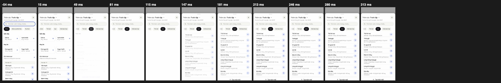
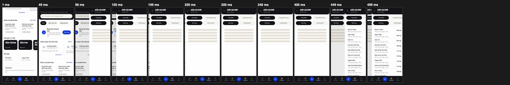
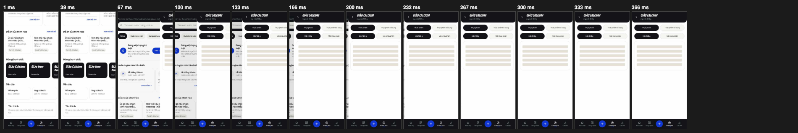

# feat/glide: every switch glides in, nothing pops; one slide on "Giàu …" (Hao, 21/10)

Stacked on `feat/minh-hao-tab` (PR #41, not merged: both touch the /add chips). It targets main and its diff includes #41's commits until that merges; after it does, this branch needs no rebase beyond dropping them. Not merged.

## 1. The double slide (first commit)

Root cause, confirmed in Chrome on the base build with `document.startViewTransition` counted: `components/route-transition.tsx` wrapped every page in `<ViewTransition default={vt}>` and `lib/nav-direction.ts` handed it `m-vt-push` for as long as the path stayed the same, so every later transition that touched the screen replayed the slide. Khám phá → Giàu Calcium started **two** (the push, then the screen's own `useDeferredValue` list render about 335 ms later), and each Giàu tab (`router.replace("?loai=…")`) started another.

Fix: `RouteTransition` keeps the last path whose commit its layout effect saw (`settled`). A render for another path is a navigation (class from `lib/nav-direction`, as before); a render for the same path is the screen itself, class `none`. So the push and back animations run once, on the navigation commit. `tests/probes/glide_vt.py` counts the calls (390 px, demo build):

| | before | after |
|---|---|---|
| Khám phá → Giàu Calcium | 2 | **1** |
| Giàu tab Thực phẩm bổ sung / back to Thực phẩm | 1 each | **0** (they glide, they are not a screen change) |
| Mỗi 100 g / Mỗi khẩu phần | 0 (hard swap) | 0 (they glide) |
| Back from Giàu, Khám phá → a food page, Hôm nay → Vi chất | 1 | 1 |
| bottom-nav tab | 0 | 0 |

## 2. One glide for content that switches in place

`components/ui/switch-glide.tsx`: `<SwitchGlide id={activeKey} order={indexOfTheActiveChip}>`. When `id` changes the content on screen fades out in 80 ms, then the new content enters 16 px off to the side the chip or tab grew toward (from the right for a later one, from the left for an earlier one) and fades in, 200 ms, the app's `--ease-out`. Web Animations API on one wrapper, transform and opacity only, nothing left behind after the end (the way in fills backwards only, the way out is cancelled when the new content is in). Interruptible: a second tap during the glide takes the next `id` once the fade-out is done and a fade-out starts from the opacity the content has at that moment (no queue, no jump). The wrapper holds the height of the content that left until the new one is in. No animation on first mount; reduced motion is a 120 ms cross-fade. While the old content leaves it draws what it last drew for the old id, so the caller's state changes at once (the chip lights on the tap) and the new list is drawn when its turn comes ("motion first, work after"). Empty states and skeletons sit inside it, so they glide too (`glide_switch.py` checks Yêu thích's empty state).

Used by: /add category chips (including Đồ ăn của Minh Hào), the compare, ingredient and training pickers (same `useFoodBrowse` chips, new `filterIndex`), Giàu (Thực phẩm | Thực phẩm bổ sung and Mỗi 100 g | Mỗi khẩu phần).

## 3. Bottom-nav tab changes glide

`EnterGlide` (same file): keyed on the tab, so the new screen is a new element that enters with `.m-tab-in`, 12 px off to the side of the tab order (Hôm nay → Tổng quan → Khám phá → Cài đặt), 200 ms, a CSS transition from `@starting-style`. The old screen does not slide out. No view-transition snapshot (cc-64's 2 GB rule): `navKind` "tab" still starts no view transition (0 counted). Used in `TabsShell` for the four tabs and in `OverviewFrame` for the Tổng quan sub-tabs (keyed on the committed tab, not the optimistic one). The tab highlight is still the optimistic one of cc-58, which does not wait for the glide.

## 4. Tokens

`:root` of `globals.css` (`--m-switch-out/in/shift`, `--m-tab-in/shift`) mirrored for JavaScript in `lib/motion.ts`; `lib/__tests__/motion.test.ts` holds the two to each other (and 150–300 ms for UI motion, the curve, `.m-tab-in` and its reduced-motion rule, the places that use the glide, AGENTS.md naming the tokens). Documented in AGENTS.md › Motion: sheets keep their spring (not touched), switch glide 200 ms / 16 px, tab glide 200 ms / 12 px, push and back once as before, reduced motion = 120 ms cross-fade only.

## 5. Measured (`_glide_measure.py`, 390 x 844 phone, 1x and 4x CPU, median of 3)

`first` = ms from the touch to the first frame where something changed; `moving` = frames in motion (glide wrapper's opacity or transform, or a view transition alive); `jank` = frames later than 25 ms / 33 ms; `pop` = frames where the content changed with nothing in motion before or after it; `vt` = view transitions started.

| switch | CPU | first (ms) before → after | moving frames before → after | jank 25 / 33 before → after | pop before → after | vt before → after |
|---|---|---|---|---|---|---|
| /add chip (Đạm) | 1x | 12.1 → 29.6 | 0 → 13 | 0/0 → 0/0 | **1 → 0** | 0 → 0 |
| /add chip (Đạm) | 4x | 9.6 → 25.3 | 0 → 13 | 0/0 → 0/0 | **1 → 0** | 0 → 0 |
| Giàu open | 1x | 28.7 → 28.7 | 42 → 21 | 0/0 → 0/0 | 0 → 0 | **2 → 1** |
| Giàu open | 4x | 42.9 → 43.2 | 20 → 21 | 1/1 → 1/1 | 0 → 0 | 1 → 1 |
| Giàu tab | 1x | 30.8 → 47.7 | 0 → 13 | 0/0 → 0/0 | **1 → 0** | 0 → 0 |
| Giàu tab | 4x | 28.3 → 44.7 | 0 → 13 | 0/0 → 0/0 | **1 → 0** | 0 → 0 |
| bottom-nav tab | 1x | 29.8 → 30.0 | 0 → 8 | 0/0 → 0/0 | **1 → 0** | 0 → 0 |
| bottom-nav tab | 4x | 45.8 → 44.3 | 0 → 9 | 1/1 → 1/1 | **1 → 0** | 0 → 0 |

Reading it: the glide costs no jank (the one late frame at 4x is in the before run too, it is the navigation itself). A chip's first change comes ~17 ms later because the first thing that changes is now the fade-out of the old list, not a hard swap; the new list is in the DOM 80 ms after the tap. At 4x CPU the median of the Giàu open "before" shows one view transition: the screen's deferred render landed inside the first transition and was batched, so the double slide shows at 1x and on a phone that keeps up (the filmstrip below is 1x).

Raw numbers: [before](feat-glide-probe-before.json), [after](feat-glide-probe-after.json). Filmstrips at 390 px, 1x, ms since the tap (`docs/screenshots/glide/{before,after}/`):

- /add chip: [before](../screenshots/glide/before/chip.png) (one frame, the list is replaced), [after](../screenshots/glide/after/chip.png) (fade out, the new list comes in from the right)
- Giàu open: [before](../screenshots/glide/before/giau-open.png) (the screen slides in at 49-150 ms and again at 449 ms), [after](../screenshots/glide/after/giau-open.png) (one slide)
- Giàu tab: [before](../screenshots/glide/before/giau-tab.png), [after](../screenshots/glide/after/giau-tab.png)
- bottom-nav tab: [before](../screenshots/glide/before/nav-tab.png), [after](../screenshots/glide/after/nav-tab.png)

## Probes

- `glide_vt.py`: view transitions per navigation and per switch, nothing left running.
- `glide_switch.py`: the list animates (opacity dips, at most 16 px, from the right for a later chip and from the left for an earlier one), no pop, ends in place with no held height, no animation on first mount, a second tap lands on the second chip, the empty state glides, Giàu tabs and basis chips, tabs from the right and the left (at most 12 px, 0 view transitions), Tổng quan sub-tabs, reduced motion (a cross-fade, nothing slides).
- `cc_46.py` / `releases.test.ts`: the new item "Chuyển nhóm, chuyển tab mượt hơn" in release 2026-10-21c (no control to learn, so no tour step).

## Not done, and why

- The light stagger (the first six rows 20 ms apart) is not built: it is marked optional, and a per-row delay would sit on top of an 80 ms fade-out and a 200 ms glide for little gain on a 390 px list. Say if you want it.
- The Vi chất chips on /micros are jump links to a group on the same page (`scrollToGroup`), not a content switch, so they do not glide. Tổng quan's 7 | 30 days toggle is a `router.replace` of the same screen with new data; it is not wrapped either (its content is the router's page, which a snapshot cannot hold).
- A tab opened from a pushed screen (for example from a food page) is a different layout, so it still has no glide: only tab → tab does.
- `public/sw.js` VERSION is not touched; re-pick it with the release id at merge (as in #41).
