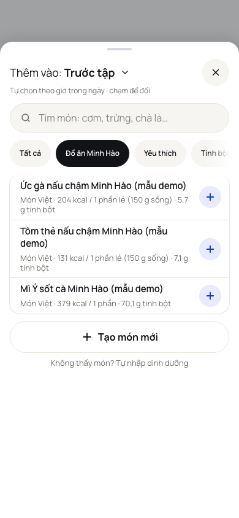
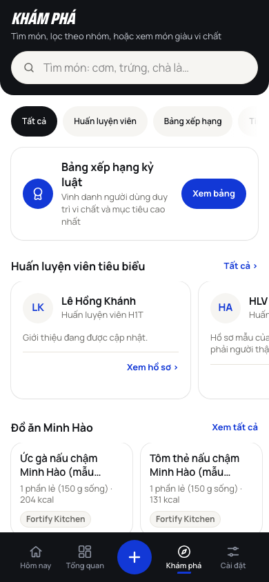

# feat/minh-hao-tab: "Đồ ăn Minh Hào" on /add and in Khám phá (Hao, 21/10)

Off origin/main 0dbd361 (the merge train #32, #33, #35, #36, #38 and #39, which brought the `fortify_kitchen` rows, are on main). PR for review, not merged.

## What it does

Foods are the catalogue rows with source `fortify_kitchen` (also any row whose brand is "Fortify Kitchen", for safety): `lib/fortify-kitchen.ts`. They are plain foods: no Thành phần, no ingredients, no dish parts (a test checks that no dish recipe of the research holds a Fortify Kitchen key, and the probe has a control that a real dish still shows its Thành phần).

1. **/add**: a chip "Đồ ăn Minh Hào" right after "Tất cả" (before Yêu thích). It lists those rows with the same row component, tray and portion sheet, and search inside it works like any group. It shows only while the catalogue has at least one such row (live catalogue before the import: no chip; if the rows go while it is picked, the list falls back to Tất cả). ChipGroup, 44 px, press feedback as they are; the probe checks the chip row does not move or change size when the chip is picked. Only the add sheet asks for it (`useFoodBrowse({ fortifyTab: true })`): the compare, ingredient and training pickers do not get the chip.
2. **Khám phá**: a carousel "Đồ ăn Minh Hào" above "Món giàu vi chất". One card per food: name, its first portion with the kcal of that portion ("1 phần lẻ (150 g sống) · 204 kcal"), the "Fortify Kitchen" tag; a tap opens the food page. "Xem tất cả" (a new `action` slot on `Carousel`) opens `/explore/minh-hao`, which is the existing `/explore/[category]` page with one more key (same header, `FoodListCard`, loading and empty states). Hidden when there are no rows; a skeleton while the live catalogue loads. Card size and spacing are the existing carousels'; `FoodCardLink` gained an optional `tag`, and `SourceTag` (the search tag) is exported from `food-list.tsx` and reused.
3. **Demo build**: three demo-only rows in `lib/mock/sample-foods.ts` (Ức gà, Tôm thẻ, Mì Ý sốt cà, all "(mẫu demo)", source `fortify_kitchen`, brand Fortify Kitchen, `demoOnly`). `lib/mock/live/sample-foods.ts` is the empty stub in the live build, so none of them ships there.
4. **Tutorials**: release `2026-10-21c` (not live yet) gains the item "Tab Đồ ăn Minh Hào" and a one-step tour (`explore-minh-hao`, fallback `nav-explore`, since Thử ngay runs on Hôm nay). The tour joins Thử ngay's 8-step cap, so older tours give up their last steps first (`releases.test.ts` updated: 23 steps from 18c on, 19b keeps two). `tutorial-targets.test.ts` is green. **`public/sw.js` VERSION is not touched here**: re-pick it from origin/main right before merging (AGENTS.md › Tutorials).
5. **Probe** `tests/probes/minh_hao_tab.py` (390 and 1280): A chip position, 44 px, list = exactly the demo rows, no shortcut cards, no layout shift, search inside the chip, a row opens the portion sheet with no Thành phần, Tab order of the chips; B no chip without the rows; C carousel above Món giàu vi chất, one card per food with the kcal of the first portion, tag, 44 px "Xem tất cả", Tab order, a card opens its food page, the list screen; D no carousel without the rows.

## Screenshots (demo build, 390 and 1280)

- /add with the chip active: [390](../screenshots/minh-hao-tab/minh-hao-add-chip-390.png), [1280](../screenshots/minh-hao-tab/minh-hao-add-chip-1280.png)
- Khám phá with the carousel: [390](../screenshots/minh-hao-tab/minh-hao-explore-390.png), [1280](../screenshots/minh-hao-tab/minh-hao-explore-1280.png)
- Xem tất cả (/explore/minh-hao): [390](../screenshots/minh-hao-tab/minh-hao-explore-list-390.png)

## Notes for review

- The food page of these rows reads "Món Việt · Fortify Kitchen · Fortify Kitchen · 150 g mỗi khẩu phần": the brand and the source name are both "Fortify Kitchen". Existing behaviour of the page, left as it is (not part of this ask).
- The real rows are category `mon_viet`, so on /add they also stay under "Món Việt" and "Tất cả"; the chip is an extra way in, not a move.
- In demo mode Khám phá shows the sample ranking and coaches above the carousel; in the live build the carousel is the first card.

## Gates

See the PR description.
